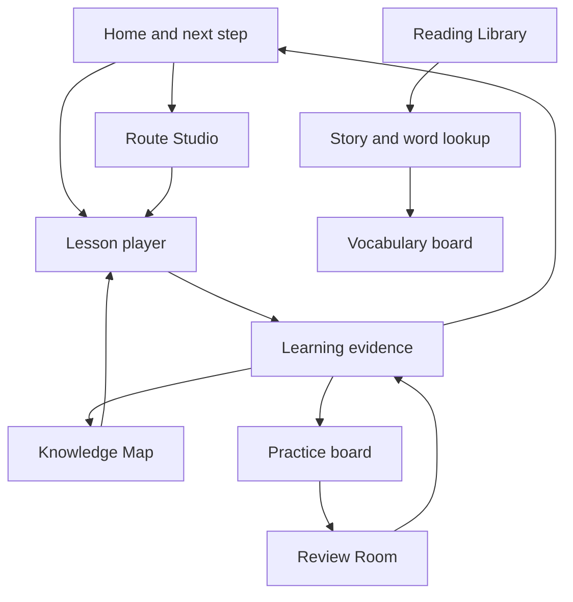

# DeutschGo app blueprint

Status: product and client implementation plan. Backend sync, account persistence, billing, and production analytics are later integrations; each screen should work with honest demo or device-local data before those services are connected.

Interactive review prototype: [open all screens and exercise types](./mockups/app-review-prototype.html). Use the left rail to switch screens, toggle desktop/phone at the top, and select each exercise type to see its interaction state.

## Product shape

DeutschGo is a guided German-learning workspace. The learner can follow a route, study a lesson, practise weak areas, review due material, read graded stories, and collect vocabulary. Every recommendation explains why it appears, and the learner can choose another path at any time.

The main learning loop is:

## App shell and visual rules

- **Phone:** five-item bottom navigation: Home, Map, Practice, Library, You. Lesson and story readers take the full content width; primary actions stay reachable near the bottom.
- **Desktop:** persistent left navigation with the same destinations; content uses a centered reading column and wider boards use a two-column layout.
- **RTL:** Arabic mirrors navigation, progress direction, and directional controls. German examples remain left-to-right within Arabic screens.
- **Visual hierarchy:** one primary action per screen; progress and status use text plus icon/color; due, local-only, draft, and synced states are explicit.
- **Shared components:** route/topic cards, progress chips, exercise feedback, empty states, confirmation panels, and localization-aware buttons.
- **States every data screen handles:** loading, ready, empty, error/retry, offline/local, and signed-out where relevant.

## Screens and connected behavior

| Screen | Appearance and main actions | Reads from / links to | Delivery |
|---|---|---|---|
| Welcome and setup | Language is chosen at the language gate; the three-step wizard selects goal, time, and route, with an optional five-question starting estimate | Device preferences → Home / Route Studio; estimate suggests a matching route | Client pilot implemented; region preference and validated adaptive placement remain planned |
| Home | Resume card for a paused lesson, next-step reason, route line with lesson/topic stations, daily goal, streak/XP/hearts, practical mission | Device checkpoint + progress + active route → saved lesson sequence, lesson, review, mission, map, Route Studio | Resume checkpoint and route recommendation are device-aware; checkpoint does not sync |
| Route Studio | Route cards with level span and progress; ordered topic list with move up/down, skip/restore, reset | Route content + progress → Home and lesson; skipped topics remain on Map | Implemented in PR #78; device-local preference |
| Knowledge Map | Search field, level/strand/state filters, concept cards with evidence state and prerequisite links; optional catch-up path | Content graph + shared progress → ordered prerequisite lessons, target topic | Search and filters are available; catch-up path expands unmet transitive prerequisites and starts the first available lesson |
| Lesson player | Objective and time estimate, structured teaching blocks, examples, all 35 supported exercise formats, row-level category feedback, completion/next-step panel | Compiled lesson content + shared evaluator → evidence, device-local checkpoint, Home, Map, Practice | The lesson player covers every deterministic format in the current exercise contract; interrupted lessons restore remaining steps and retry order on the same device |
| Practice board | Weak topics, due count, session estimate, mission list, resume actions | Evidence and due classification → Review Room, lesson, mission | Implemented; expand when skill types arrive |
| Review Room | Due queue oldest first, 3/5/10 session size, topic opt-out, one exercise at a time, recall feedback | Due evidence + lesson exercise bank → evaluator and evidence | Implemented in merged PR #78; its hosted CI passed |
| Practical mission | Scenario briefing, German prompt, reply choices, explanation, finish summary | Authored scenario + lesson evaluator → evidence and lesson | Implemented for authored missions |
| Reading Library | Level-labelled original stories, reading-time and saved/due counts | Reading catalogue + local vocabulary → story, vocabulary | Implemented in PR #78 |
| Story reader | German text in a calm reading column; selectable words open a contextual meaning panel with the sentence and save action | Story content → local vocabulary board; related concept can open Map | Implemented in PR #78; dictionary breadth planned |
| Dictionary | Searchable word list with a selected entry, translation, original sentence, source story, and save action | Original reading tokens → local vocabulary scheduler and story reader | Client screen at `/{lang}/dictionary`; coverage follows the glossed word inventory in published reading stories |
| Vocabulary board | Front/back flashcard, “Again” and “I remembered”, due/scheduled lists, remove action | Device-local word occurrences → scheduler and story context | Implemented in PR #78; no account sync yet |
| Progress board | Totals and recent activity; skill filters; expandable topic result and answer history | Shared account/device evidence → Home, Map, Practice, and source lesson | Per-skill and per-topic figures come from recorded answers; no invented mastery or streaks |
| You / profile | Goal, language, account state, progress source, reminder controls, device backup export/restore, clear data and sign-out | Device preferences and account APIs → settings and privacy actions | Device JSON backup is previewed and restored locally with confirmation; account progress import/export uses the progress API |
| Sign-in and session | Provider handoff, callback/loading/error, signed-in state, refresh and sign-out | Auth provider → profile, progress APIs | API/UI foundations exist; provider configuration is pending |

## Shared logic and data flow

### Learning evidence

Lessons, review sessions, and missions use the same evaluator and record an attempt with a unique event id. The client updates its visible progress immediately and queues the event when offline. Home, Practice, and Map derive their status from the same merged progress view. Repeated events are ignored by id; a wrong answer shows a reason and a future retry opportunity.

### Recommendation order

The Home recommendation selects the most useful available action in this order: due review, repeated error, missing prerequisite, then the next active-route lesson. The card states the reason and offers a way to choose another topic. Route changes reorder or hide only route stations; they never erase learning evidence.

### Route state

The active route id, custom step order, and skipped ids are stored locally for now. The route planner filters hidden steps and the Home route line and next-step card consume the same result. Reset restores the authored order. Clearing device data removes route preferences.

### Reading and vocabulary state

Each saved card identifies a story, paragraph, and exact token occurrence. Different uses of the same word stay separate. The learner recalls before revealing the meaning. “Again” schedules ten minutes; remembered cards advance through 1, 3, 7, 16, and 35 days. Local storage errors must be visible and recoverable.

### Backend boundary

Screens call typed client interfaces for progress, attempts, routes, and vocabulary. Device adapters work first; server adapters can later replace them without changing screen flows. Do not label data synced until the server confirms it. Account route sync and saved-vocabulary persistence need explicit schemas before activation.

## Feature roadmap

### 1. Stabilize current client loop

- Keep the profile clear-data journey aligned with its localized confirmation and current device-data scope.
- Check route, lesson, review, mission, story, vocabulary, profile and map transitions on phone and desktop, including empty and offline states.
- Add a route-specific browser journey and accessibility checks for keyboard operation, contrast, focus, and Arabic direction.

### 1a. First-run study plan (implemented slice)

- Add `/{lang}/start`: choose learning goal and daily time, select a course route, review the plan, and save both preferences locally.
- Link the Home daily-goal plan action to this wizard. Saving sends the learner back to Home, where the active route drives the learning line.
- Add a five-question optional estimate stored on this device and use its A0/A1 band to suggest a route without locking the learner in. Calibration, skill-specific placement, and DACH region selection remain future work.

### 2. Finish the learning experience

- Make first-run setup produce an editable recommended route and a short diagnostic estimate with a confidence range.
- Keep map search/filtering and one-click catch-up sequences current as lesson coverage grows; missing lessons remain visible without blocking free exploration.
- Let learners tune goals and study time; progress now filters recorded answers by skill and shows evidence for each practiced topic.
- Add audio/listening, guided writing, and speaking only with clearly stated evaluation limits.

### 3. Expand the content product

- Add reviewed graded texts, dialogues, audio, and dictionary senses linked to concepts and exercises.
- Track source, rights, language coverage, review status, and regional variants for every learning item.
- Keep machine translations marked as drafts until reviewed; test RTL and German text in each supported locale.

### 4. Connect backend services

- Define versioned contracts for attempts/progress, route preferences, saved vocabulary and word senses.
- Add idempotent offline sync and conflict behavior; make account import/export and deletion clear and auditable.
- Configure authentication providers, reminders, backups, monitoring, and privacy-preserving analytics.
- Add entitlements and billing after core retention and value are validated.

## Verification gates

- Every main screen has phone and desktop layouts, keyboard access, visible focus, and loading/empty/error states.
- A user journey can be followed end-to-end: setup → route → lesson → feedback → progress → review; and Library → story → saved word → review.
- UI progress always comes from the shared evidence model; local-only data is labelled and clearable.
- CI passes foundation, content validation, tests/typecheck/build, database checks, Playwright, and accessibility checks before the PR is considered ready.

## Current verification

PR #119 passed all four CI groups, including Playwright and accessibility checks. The profile clear-data journey asserts the current localized scope. Keep this screen journey green when changing profile data actions.

### Аудирование с выбором смысла

Плеер озвучивает авторскую немецкую фразу через встроенный синтез речи браузера (`de-DE`), поддерживает повтор и скрывает текст во время обычного режима. Если браузер не поддерживает синтез, показывает транскрипт и оставляет упражнение доступным. Ответ выбирается из локализованных вариантов; после проверки отображаются верный вариант и объяснение. Озвучка запускается только по нажатию пользователя и отменяется при переходе к следующему экрану.
### Диктант с озвучкой

Ученик слушает немецкое предложение, при желании повторяет озвучку и вводит услышанный текст. Оценщик сравнивает ввод с редакторским списком принятых предложений после общей нормализации регистра первой буквы, пробелов и финальной пунктуации. При недоступном синтезе речи показывается транскрипт.
### Исправление ошибки

Показывает предложение с намеренной ошибкой и поле для полной исправленной версии. Проверка принимает редакторские варианты и может распознать заранее описанную типичную ошибку, чтобы объяснить правило и записать диагностический сигнал.

### Тренировка минимальных пар

Плеер озвучивает целевое слово и отдельно каждый вариант. Ученик выбирает написание, соответствующее звучанию; целевую фразу можно повторить. При недоступной озвучке отображается текстовая опора и явное сообщение о переходе в режим сравнения написаний.

## Writing Studio

The writing board offers realistic A1–A2 message prompts and an illustrated A1 picture prompt, a focused draft editor, a live word count, and a reusable self-review checklist. Drafts are stored per language on the learner’s device only. The board does not claim automated language grading and does not add writing drafts to learning-progress events. It is linked from Practice and supports four interface languages.

## Speaking workshop
The device-local speaking workshop offers three practical A1 prompts, optional browser speech playback, and an explicit microphone action followed by playback or deletion. Audio is held in page memory only, never uploaded, and is discarded when the learner leaves. It does not claim pronunciation scoring or automated assessment. It is linked from Practice and translated in en/ru/uk/ar.

## Dedicated progress board
The `/{lang}/progress` screen reuses the account/device evidence provider to show actual answer totals, accuracy, and concept-state counts. It is reachable from the learner profile and links to Home, Map, and Practice. It does not invent XP, streaks, or certification from attempt data.

The progress breakdown filters saved attempts by knowledge, reading, listening, writing, or speaking. Expanding a topic shows its evidence-derived state, correct/total counts, timestamped answer history, links to source lessons, and a return to the topic on the map. Empty skill filters remain explicit and never show fabricated scores.
